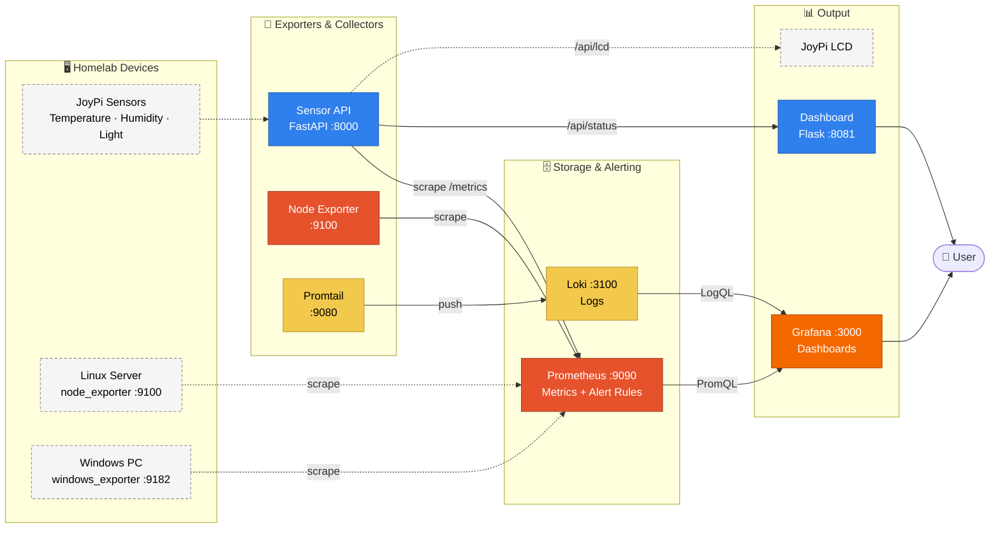

# Smart Homelab Monitoring System

Mini project for **Module 321 – Programming Distributed Systems**.

A central monitoring system that watches both the IT infrastructure and the physical environment of a home lab. It collects metrics from Linux and Windows machines as well as sensor data from a JoyPi, stores them centrally, visualises them in dashboards and raises alerts when something goes wrong.

The system consists of **seven services**, each running in its own Docker container and communicating exclusively over the network (HTTP).

---

## Table of Contents

- [Architecture](#architecture)
- [Services](#services)
- [Quick Start](#quick-start)
- [Configuration (.env)](#configuration-env)
- [Metrics](#metrics)
- [Alerts](#alerts)
- [Sensor API Endpoints](#sensor-api-endpoints)
- [Project Structure](#project-structure)
- [Adding Real Hosts](#adding-real-hosts)
- [Current Status & Limitations](#current-status--limitations)
- [Troubleshooting](#troubleshooting)
- [License](#license)

---

## Architecture

Arrows show the direction of the data flow. Prometheus uses a **pull model**: it queries the exporters itself at fixed intervals ("scrape"). Promtail, on the other hand, actively **pushes** logs to Loki. Dashed elements live outside the Docker stack or are not connected yet.



### Two separate data paths

| Path | Flow | Query language |
|------|------|----------------|
| **Metrics** | Exporters → Prometheus → Grafana | PromQL |
| **Logs** | Container & system logs → Promtail → Loki → Grafana | LogQL |

---

## Services

| Service | Technology | Host port | Purpose |
|---------|------------|-----------|---------|
| **sensor-api** | Python · FastAPI | `8000` | Exposes sensor data as Prometheus metrics (`/metrics`) and as JSON (`/api/status`) |
| **dashboard** | Python · Flask | `8081` | Custom overview page with health score and light/dark mode based on ambient light |
| **prometheus** | Prometheus | `9090` | Scrapes metrics every 15 s, stores them (1 day) and evaluates alert rules |
| **node-exporter** | Node Exporter | `9100` | Exposes system metrics (CPU, RAM, disk, network) |
| **loki** | Grafana Loki | `3100` | Stores logs (24 h retention) |
| **promtail** | Promtail | – | Reads Docker container logs and `/var/log` and ships them to Loki |
| **grafana** | Grafana | `3000` | Dashboards for metrics and logs; data sources and dashboard are provisioned automatically |

All services share the Docker network `monitoring` and reach each other by service name (e.g. `http://sensor-api:8000`).

---

## Quick Start

**Requirements:** [Docker](https://docs.docker.com/get-docker/) with Docker Compose (Docker Desktop on Windows/macOS is fine).

```bash
# 1. Clone the repository
git clone <repo-url>
cd homelab-monitoring-system

# 2. Create the config file and set a password
cp .env.example .env

# 3. Build and start the stack
docker compose up --build -d
```

The web interfaces are then available at:

| Interface | URL | Login |
|-----------|-----|-------|
| Dashboard | http://localhost:8081 | – |
| Grafana | http://localhost:3000 | values from `.env` |
| Prometheus | http://localhost:9090 | – |
| Prometheus alerts | http://localhost:9090/alerts | – |
| Sensor API (Swagger docs) | http://localhost:8000/docs | – |

In Grafana, the prepared dashboard is located under **Dashboards → Monitoring → Homelab Overview**.

**Stopping:**

```bash
docker compose down        # stop containers, data is kept
docker compose down -v     # also delete all data (volumes)
```

---

## Configuration (.env)

Credentials are not stored in the code but in a `.env` file in the project root. Docker Compose loads it automatically. The file is listed in `.gitignore` and is **not** committed; `.env.example` serves as a template.

| Variable | Description | Example |
|----------|-------------|---------|
| `GRAFANA_ADMIN_USER` | Grafana admin username | `admin` |
| `GRAFANA_ADMIN_PASSWORD` | Grafana admin password (required) | `change-me` |

> **Note:** Grafana only applies the password on the **first** start and then stores it in the `grafana_data` volume. To change it later:
> ```bash
> docker exec -it grafana grafana cli admin reset-admin-password <new-password>
> ```

Run `docker compose config` to check that the values are substituted correctly.

---

## Metrics

The Sensor API exposes the following metrics at `http://localhost:8000/metrics`:

| Metric | Unit | Description |
|--------|------|-------------|
| `homelab_temperature_celsius` | °C | Room temperature |
| `homelab_humidity_percent` | % | Humidity |
| `homelab_light_lux` | lux | Ambient light (controls light/dark mode, threshold 500 lux) |
| `homelab_door_open` | 0 / 1 | Door state |
| `homelab_motion_detected` | 0 / 1 | Motion detected |
| `homelab_cpu_usage_percent` | % | CPU usage |
| `homelab_memory_usage_percent` | % | Memory usage |
| `homelab_disk_usage_percent` | % | Disk usage |
| `homelab_uptime_seconds` | s | Time since the Sensor API started |
| `homelab_health_score` | 0–100 | Overall homelab health (see below) |

In addition, Node Exporter provides the standard `node_*` metrics (e.g. `node_cpu_seconds_total`, `node_memory_MemAvailable_bytes`, `node_filesystem_avail_bytes`).

### Health score

The health score sums up the overall state in a single number. It starts at 100 and is reduced when thresholds are exceeded:

| Condition | Deduction |
|-----------|-----------|
| CPU above 80 % | 0.6 points per % |
| RAM above 80 % | 0.5 points per % |
| Disk above 80 % | 0.7 points per % |
| Temperature above 30 °C | 1.2 points per °C |
| Door open | 8 points |
| Motion detected | 2 points |

---

## Alerts

The rules are defined in [`services/prometheus/alert_rules.yaml`](services/prometheus/alert_rules.yaml) and evaluated by Prometheus every 15 s. Active alerts are shown at http://localhost:9090/alerts.

| Alert | Condition | Duration | Severity |
|-------|-----------|----------|----------|
| `HighTemperature` | Temperature > 30 °C | 2 min | warning |
| `HighDiskUsage` | Disk > 85 % | 5 min | warning |
| `SensorApiDown` | Sensor API unreachable | 1 min | critical |

The duration prevents false alarms: an alert only fires once the condition has been true for the whole period (state *pending* → *firing*).

---

## Sensor API Endpoints

| Method | Path | Description |
|--------|------|-------------|
| `GET` | `/health` | Liveness check |
| `GET` | `/api/status` | All current values as JSON (used by the dashboard) |
| `GET` | `/api/lcd` | Short status line for the LCD display, e.g. `TEMP: 23.4C HUM: 51.2%` |
| `GET` | `/metrics` | Metrics in Prometheus format |
| `GET` | `/docs` | Auto-generated API documentation (Swagger) |

Example:

```bash
curl http://localhost:8000/api/status
```

---

## Project Structure

```
.
├── docker-compose.yaml          # Definition of all services
├── .env.example                 # Template for credentials
└── services/
    ├── sensor-api/              # FastAPI: sensor data → metrics & JSON
    ├── dashboard/               # Flask: custom overview page
    │   ├── templates/index.html
    │   └── static/styles.css
    ├── prometheus/
    │   ├── prometheus.yaml       # Scrape targets
    │   └── alert_rules.yaml      # Alert rules
    ├── grafana/
    │   ├── provisioning/        # Data sources & dashboard provider (automatic)
    │   └── dashboards/          # Dashboard as JSON
    ├── loki/loki.yaml           # Log storage
    └── promtail/promtail.yaml   # Log collector
```

---

## Adding Real Hosts

The Node Exporter in the stack runs inside Docker; under Docker Desktop it measures the Docker VM, **not** the actual machine. For real host metrics:

**Windows**

1. Install [`windows_exporter`](https://github.com/prometheus-community/windows_exporter/releases) (listens on port `9182`).
2. Add to `services/prometheus/prometheus.yaml`:
   ```yaml
   - job_name: 'windows'
     static_configs:
       - targets: ['host.docker.internal:9182']
   ```

**Linux**

1. Install `node_exporter` directly on the server, or run it as a container with host access (`--net=host --pid=host -v /:/host:ro,rslave`).
2. Add the target to `prometheus.yaml`, e.g. `192.168.1.50:9100`.

Then restart Prometheus: `docker compose restart prometheus`. The new target should show as **UP** at http://localhost:9090/targets.

---

## Current Status & Limitations

| Area | Status |
|------|--------|
| Docker stack, Prometheus, Loki, Grafana | ✅ working |
| Grafana provisioning (data sources & dashboard) | ✅ automatic |
| Alert rules in Prometheus | ✅ active |
| Sensor values (temperature, humidity, light) | ⚠️ simulated, JoyPi integration in progress |
| CPU / RAM / disk in the Sensor API | ⚠️ simulated |
| Door and motion sensor | ⚠️ prepared, value always 0 |
| LCD output | ⚠️ `/api/lcd` endpoint only, no driver |
| Alert notifications (Discord / email) | ❌ not implemented yet |
| Windows / Linux hosts | ❌ manual setup required (see above) |

---

## Troubleshooting

| Problem | Solution |
|---------|----------|
| Port already in use | Change the port left of the colon in `docker-compose.yaml`, e.g. `'3001:3000'` |
| Grafana login fails | The password was set on first start → [reset it](#configuration-env) |
| Grafana dashboard is empty | Check http://localhost:9090/targets – all targets must be **UP** |
| No logs in Loki | Promtail needs access to `/var/run/docker.sock`; on Windows `/var/log` is empty |
| Python code changes have no effect | Rebuild: `docker compose up --build -d` |
| View logs of a service | `docker compose logs -f sensor-api` |

---

## License

[MIT](LICENSE)
